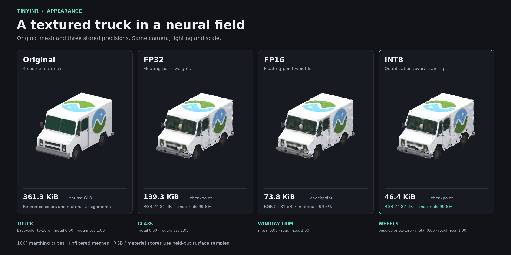
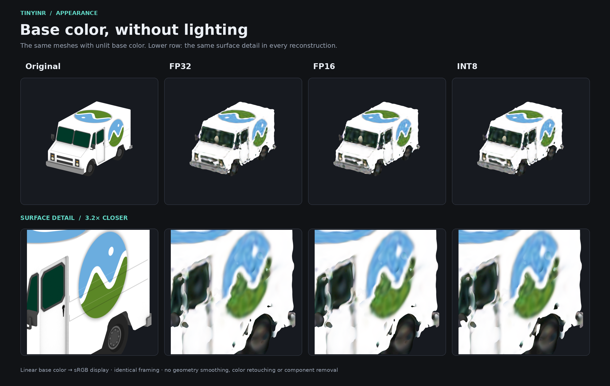
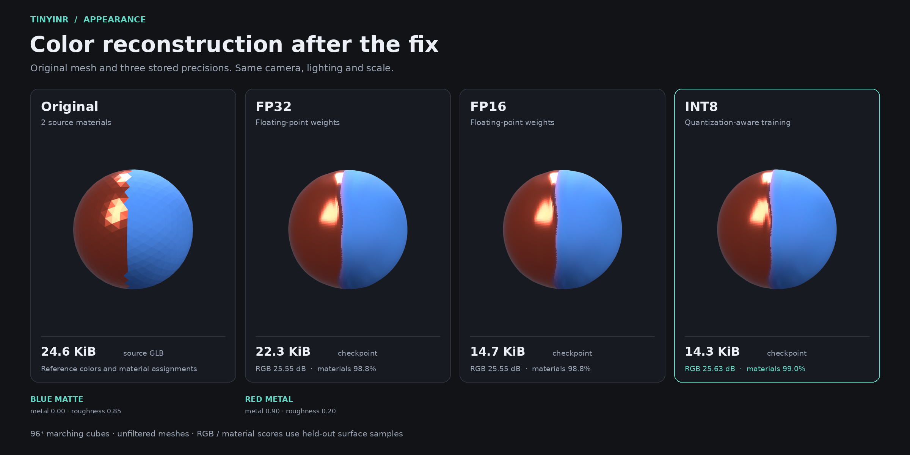

<div align="center">

# TinyINR

Fourier-KAN signed distance fields, small enough to sit next to a mesh codec.

[](https://www.python.org/downloads/)
[](https://pytorch.org/)
[](LICENSE)

A mesh becomes a continuous field: a Fourier-KAN front end, sine layers, then a linear SDF head. Marching cubes turns the field back into a surface. INT8 quantization-aware training keeps the weights in the same size range as Google Draco.


</div>

---

## Films

The sword and the shield share one camera. The first clip moves the surface itself. The second blends the learned fields.

**Surface flow.** Points travel by height and angle, so the blade widens into the shield instead of fading out.

<p align="center">
  
</p>

<p align="center">
  <a href="docs/flow_sword_shield.mp4">flow_sword_shield.mp4</a>
</p>

**Field morph.** The trained sword SDF and the trained shield SDF are warped onto a shared silhouette, clipped, and blended. Both endpoints are float networks (width 768).

<p align="center">
  
</p>

<p align="center">
  <a href="docs/morph_sword_shield.mp4">morph_sword_shield.mp4</a>
</p>

```bash
python films.py --fps 30
python morph.py \
  --model-a weights/sword_fine/sword_fp32.pth \
  --model-b weights/shield_detail/shield_fp32.pth \
  --yaw-b 0 --resolution 160 --smooth 0.5 --steps 90 --fps 30 \
  --out morph_sword_shield.mp4
```

---

## Bunny vs Draco

Stanford bunny, original PLY 2.96 MB. Each TinyINR column is an INT8 checkpoint. Each Draco column is quantization level 10 at the bit depth that lands on the same file size. Chamfer is the symmetric mean nearest-neighbor distance on 100,000 surface samples. The INR meshes are marching cubes at 176³.

<p align="center">
  
</p>

| Method | Precision | File size | Chamfer ↓ | Compression |
| :--- | :--- | :---: | :---: | :---: |
| TinyINR, width 128 | INT8 | 80.7 KB | 0.00129 | 36.7× |
| TinyINR, width 64 | INT8 | 28.0 KB | 0.00044 | 105.8× |
| **TinyINR, width 16** | **INT8** | **8.7 KB** | **0.00088** | **340×** |
| Draco, level 10 | 15-bit | 86.7 KB | 0.00038 | 34.2× |
| Draco, level 10 | 9-bit | 28.8 KB | 0.00038 | 102.8× |
| Draco, level 10 | 3-bit | 8.7 KB | 0.00418 | 340× |

At 28 KB and 80 KB, Draco stays sharper. At 8.7 KB the width-16 field still has ears, a head and a tail. Draco at 3 bits, same size, no longer reads as a rabbit. That gap is about 4.8× in Chamfer (0.00088 against 0.00418).

```bash
python compare.py --mesh bunny
python reconstruct.py --weights weights/bunny_64/bunny_int8.pth --mesh bunny --out bunny_recon.obj
```

---

## Architecture

```
Normalized coordinates (x, y, z)
        │
        ▼
┌──────────────────────────────────────────┐
│ Fourier-KAN                              │
│ φ(x) = Σ [ a cos(k·s·x) + b sin(k·s·x) ] │
└──────────────────────────────────────────┘
        │
        ▼
┌──────────────────────────────────────────┐
│ Sine MLP                                 │
│ y = sin(ω₀ · Wx + b)                     │
└──────────────────────────────────────────┘
        │
        ▼
┌──────────────────────────────────────────┐
│ Linear head  →  SDF                      │
└──────────────────────────────────────────┘
        │
        ▼
Marching cubes  →  mesh
```

Fourier features replace B-splines. Each input coordinate is a short harmonic series, contracted with `einsum`. The sine stack then uses ω₀ = 30 and an input scale of 3, unless a checkpoint stores other values.

INT8 training has two stages. AdamW with `ReduceLROnPlateau` fits the field in FP32. Quantization-aware fine-tuning then fake-quantizes weights with a straight-through estimator and a per-channel scale:

`s = max|W| / 127`, then `Wq = clamp(round(W / s), -127, 127)`.

---

## Quickstart

```bash
git clone https://github.com/Tomek2008/TinyINR.git
cd TinyINR
pip install -r requirements.txt
```

```bash
python train.py --mesh bunny --hidden 64 --epochs 200 --qat-epochs 100 --out weights/bunny_64
python train.py --mesh bunny --hidden 16 --epochs 200 --qat-epochs 100 --out weights/bunny_16
```

`--eikonal`, `--clamp` and `--band` tighten the surface when the mesh is thin. The sword film was trained with a lower ω₀, a clamp and band sampling. The shield kept ω₀ = 30 and no clamp, so the rivets stay.

---

## Learning mesh colors and materials

The appearance pipeline trains a shared Fourier-KAN backbone with three heads:
signed distance, linear RGBA, and material logits. Surface samples carry colors
and material labels; off-surface samples supervise only geometry. The existing
`train.py` / `reconstruct.py` pipeline remains available for geometry-only models.

**A textured, four-material truck.** Cesium Milk Truck tests shape, texture,
windows and wheels together. This run uses width 96, three sine layers, 60,000
SDF samples, 40,000 appearance samples, 180 FP32 epochs and 20 QAT epochs.
Reconstruction uses marching cubes at 160³. All views use the same Blender
Cycles camera, scale and lighting. File sizes describe the source GLB or the
complete checkpoint, including normalization and the material palette.

<p align="center">
  
</p>

**Texture detail.** The unlit comparison isolates base color; the lower row
zooms in on the same area of the body. Fine graphics and thin features remain
less accurate than the source. The source has open geometry, which also makes
SDF supervision approximate near openings. No geometry smoothing, color
retouching or component removal is applied.

<p align="center">
  
</p>

| Truck weights | Size | Linear RGB PSNR ↑ | Material accuracy ↑ | Mean surface distance ↓ | Geometry F-score ↑ |
| :--- | ---: | ---: | ---: | ---: | ---: |
| FP32 | 139.3 KiB | 24.81 dB | 99.55% | 0.00381 | 91.82% |
| FP16 | 73.8 KiB | 24.81 dB | 99.53% | 0.00379 | 91.87% |
| INT8 | 46.4 KiB | 24.82 dB | 99.58% | 0.00390 | 91.51% |

RGB and material scores use held-out points on the source surface. Geometry
scores use 20,000 independently sampled points in each direction and nearest
triangle distances. Distances are normalized so the source's longest half-extent
is 1; the F-score threshold is 0.01. All three truck checkpoints have positive
SDF on the tested reconstruction boundary. The trained field still contains
small disconnected fragments; the count is not forced to match the source.

**Why the first sphere had extra discs.** A Fourier-only front end repeats every
`2π / input_scale` along each axis. The old scale of 3 gave a period of 2.094,
smaller than the reconstruction domain's width of 2.4. This made some exterior
points indistinguishable from interior points. Marching cubes then extracted
the repeated surfaces and capped negative regions at the grid boundary.
More epochs or INT8 tuning cannot remove that representational ambiguity.

The corrected sphere below changes only the Fourier scale from 3 to 1:
same width 32, two sine layers, samples, seed, 60 FP32 epochs and 10 QAT epochs.
The current pipeline also samples the full reconstruction bounds and their
boundary, and rejects scales whose period overlaps that domain.

<p align="center">
  
</p>

| Sphere INT8 | Mean surface distance ↓ | F-score ↑ | Components | Negative boundary |
| :--- | ---: | ---: | ---: | ---: |
| Scale 3, before | 0.04415 | 73.3% | 7 | 10.3% |
| Scale 1, after | 0.00154 | 99.9% | 1 | 0.0% |

Both sphere meshes use a 96³ grid. Their color boundary is still softened by the
small continuous color network. The prior explanation attributing the discs
only to a short training run was incomplete: periodic aliasing was the main cause.
Numeric results are recorded in [appearance_benchmarks.json](docs/appearance_benchmarks.json).

Supported appearance inputs are OBJ with MTL and base-color textures, GLB/GLTF
scenes, and meshes with vertex or face colors, including PLY. Scene transforms,
instances, UV seams and per-face material assignments are retained. Material
identity is learned as a classification task. The checkpoint stores a palette
of constant roughness, metallic, emissive and alpha settings; these settings
are carried from the source, not estimated from rendered images. MTL diffuse
colors and specular exponents are converted to base color and roughness.

```bash
python train_appearance.py \
  --mesh assets/model.glb --hidden 128 --layers 4 \
  --epochs 200 --qat-epochs 100 \
  --samples 500000 --appearance-samples 200000 \
  --out weights/model_appearance

python reconstruct_appearance.py \
  --weights weights/model_appearance/model_appearance_int8.pth \
  --resolution 192 --out weights/model_appearance/reconstruction.glb
```

Every FP32, FP16 and INT8 checkpoint contains the architecture, normalization
and material palette. Reconstruction needs only the checkpoint. GLB stores
predicted colors at vertices and assigns materials to faces using predictions
at face centroids. PLY output (`--out reconstruction.ply`) stores vertex RGBA
without PBR materials. For sharper color boundaries and finer texture details,
increase reconstruction resolution as well as model capacity and surface samples.

`appearance_metrics.json` records validation SDF MSE, linear RGB PSNR, RGBA MSE,
material accuracy, exterior boundary sign and checkpoint sizes. Ten percent of each sample set is held
out for validation and selecting the best epoch. Geometry and appearance have
separate batches. `--color-weight` (default `0.1`) and `--material-weight`
(default `0.01`) control their contribution relative to SDF loss. `--clamp`,
`--eikonal` and `--band` support thin geometry; clamp and eikonal also apply
during QAT. Sampling perturbations and clamp distances use normalized coordinates.
Use `--qat-epochs 0` to save only floating-point models and `--seed` for repeatable
sampling and initialization on the same device.

Appearance training defaults to `--input-scale 1.0`. The encoding period must
exceed the padded reconstruction domain on every axis; invalid scales fail before
training. Legacy checkpoints remain readable and reconstruction warns about
overlapping periods or negative SDF on the grid boundary.

Reproduce the truck benchmark using the included, attributed source asset:

```bash
python train_appearance.py \
  --mesh assets/appearance/CesiumMilkTruck.glb --hidden 96 --layers 3 \
  --epochs 180 --qat-epochs 20 --samples 60000 --appearance-samples 40000 \
  --batch-size 2048 --lr 0.0005 --input-scale 1 --out weights/appearance_truck_fixed
python render_appearance.py \
  --run weights/appearance_truck_fixed --prefix truck --resolution 160 \
  --title "A textured truck in a neural field" --view 4 -6 2.8 \
  --detail-center 0.45 0.2 0.1 --ortho-scale 2.7 --detail-scale 0.85
python evaluate_appearance.py --run weights/appearance_truck_fixed --resolution 160
```

`evaluate_appearance.py` writes a separate `geometry_metrics.json` with distances,
F-score, component counts and boundary diagnostics; color scores alone do not
measure reconstruction geometry.

To try the complete pipeline without downloading an asset, generate a sphere
with a red metal half and a blue matte half:

```bash
python examples/make_appearance_demo.py --out weights/appearance_demo/source.glb
python train_appearance.py \
  --mesh weights/appearance_demo/source.glb --hidden 32 --layers 2 \
  --epochs 60 --qat-epochs 10 --samples 8192 --appearance-samples 4096 \
  --batch-size 512 --lr 0.001 --out weights/appearance_demo
python reconstruct_appearance.py \
  --weights weights/appearance_demo/source_appearance_int8.pth \
  --resolution 96 --out weights/appearance_demo/reconstruction.glb
```

Render comparison figures after training the demo (requires the Blender
executable on `PATH`; rendered tiles and the render manifest stay in the run folder):

```bash
python render_appearance.py --run weights/appearance_demo --prefix sphere --out docs
```

Use `--blender /path/to/blender` for a custom installation, or `--compose-only`
to rebuild the figure layout from existing rendered tiles. `--samples`,
`--tile-size` and `--threads` control rendering quality and CPU use.

Base-color textures are sampled with bilinear filtering and repeat wrapping.
Texture color is converted from sRGB to linear before training, and combined
with material factors and vertex colors. Texture sampler modes, UV transforms,
normal maps, occlusion maps and spatially varying metallic/roughness/emissive maps
are not reproduced. Unsupported PBR maps produce a warning. Input geometry should
be closed and consistently oriented for meaningful signed distances. A source
without appearance data receives a white fallback; the bundled sword/shield OBJ
files have little material information and are not a useful color benchmark.

Run the regression suite, including a short CPU training/QAT/reconstruction test:

```bash
pip install pytest
python -m pytest -q tests/test_appearance.py
```

---

## Asset attributions

* **Sword:** *Sword* by blaeksprut ([CC-BY](https://creativecommons.org/licenses/by/3.0/)) via Poly Pizza.
* **Shield:** *Shield* by Quaternius (public domain / CC0).
* **Bunny and Armadillo:** Stanford Computer Graphics Laboratory 3D Scanning Repository.
* **Cesium Milk Truck:** © 2017 Cesium, [CC BY 4.0](https://creativecommons.org/licenses/by/4.0/), via [Khronos glTF Sample Assets](https://github.com/KhronosGroup/glTF-Sample-Assets/tree/main/Models/CesiumMilkTruck). [Asset source, hash and logo notice](assets/appearance/README.md).

This project is licensed under the [MIT License](LICENSE).
