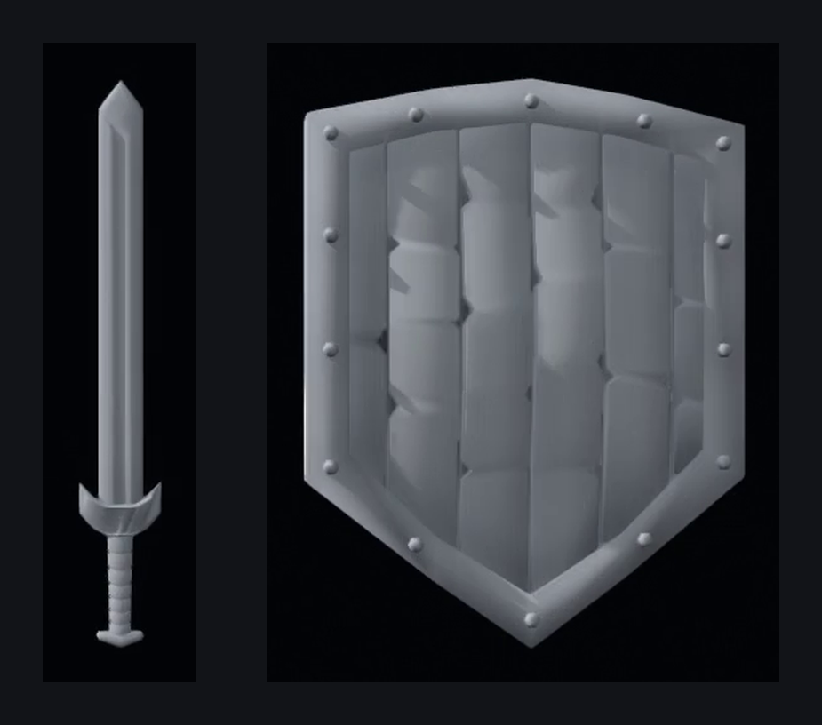
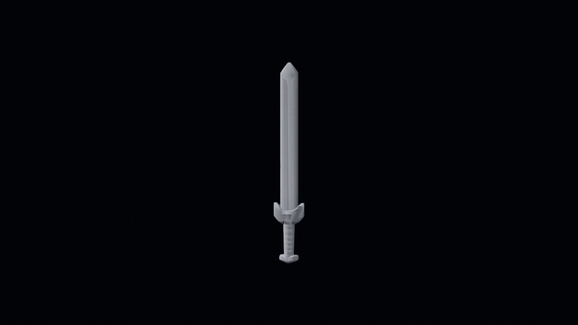
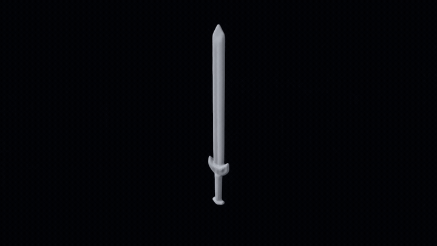
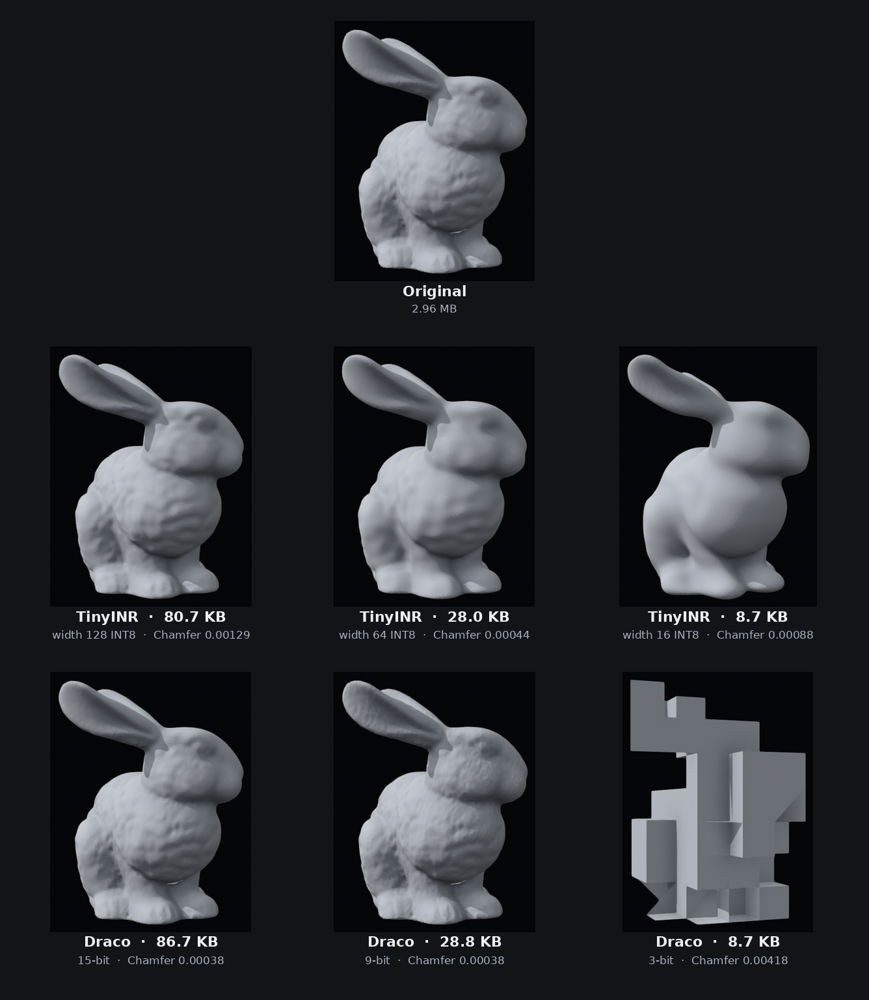

<div align="center">

# TinyINR

Fourier-KAN signed distance fields, small enough to sit next to a mesh codec.

[](https://www.python.org/downloads/)
[](https://pytorch.org/)
[](LICENSE)

A mesh becomes a continuous field: a Fourier-KAN front end, sine layers, then a linear SDF head. Marching cubes turns the field back into a surface. INT8 quantization-aware training keeps the weights in the same size range as Google Draco.



</div>

---

## Films

The sword and the shield share one camera. The first clip moves the surface itself. The second blends the learned fields.

**Surface flow.** Points travel by height and angle, so the blade widens into the shield instead of fading out.

<p align="center">
  
</p>

<p align="center">
  <a href="docs/flow_sword_shield.mp4">flow_sword_shield.mp4</a>
</p>

**Field morph.** The trained sword SDF and the trained shield SDF are warped onto a shared silhouette, clipped, and blended. Both endpoints are float networks (width 768).

<p align="center">
  
</p>

<p align="center">
  <a href="docs/morph_sword_shield.mp4">morph_sword_shield.mp4</a>
</p>

```bash
python films.py --fps 30
python morph.py \
  --model-a weights/sword_fine/sword_fp32.pth \
  --model-b weights/shield_detail/shield_fp32.pth \
  --yaw-b 0 --resolution 160 --smooth 0.5 --steps 90 --fps 30 \
  --out morph_sword_shield.mp4
```

---

## Bunny vs Draco

Stanford bunny, original PLY 2.96 MB. Each TinyINR column is an INT8 checkpoint. Each Draco column is quantization level 10 at the bit depth that lands on the same file size. Chamfer is the symmetric mean nearest-neighbor distance on 100,000 surface samples. The INR meshes are marching cubes at 176³.

<p align="center">
  
</p>

| Method | Precision | File size | Chamfer ↓ | Compression |
| :--- | :--- | :---: | :---: | :---: |
| TinyINR, width 128 | INT8 | 80.7 KB | 0.00129 | 36.7× |
| TinyINR, width 64 | INT8 | 28.0 KB | 0.00044 | 105.8× |
| **TinyINR, width 16** | **INT8** | **8.7 KB** | **0.00088** | **340×** |
| Draco, level 10 | 15-bit | 86.7 KB | 0.00038 | 34.2× |
| Draco, level 10 | 9-bit | 28.8 KB | 0.00038 | 102.8× |
| Draco, level 10 | 3-bit | 8.7 KB | 0.00418 | 340× |

At 28 KB and 80 KB, Draco stays sharper. At 8.7 KB the width-16 field still has ears, a head and a tail. Draco at 3 bits, same size, no longer reads as a rabbit. That gap is about 4.8× in Chamfer (0.00088 against 0.00418).

```bash
python compare.py --mesh bunny
python reconstruct.py --weights weights/bunny_64/bunny_int8.pth --mesh bunny --out bunny_recon.obj
```

---

## Architecture

```
Normalized coordinates (x, y, z)
        │
        ▼
┌──────────────────────────────────────────┐
│ Fourier-KAN                              │
│ φ(x) = Σ [ a cos(k·s·x) + b sin(k·s·x) ] │
└──────────────────────────────────────────┘
        │
        ▼
┌──────────────────────────────────────────┐
│ Sine MLP                                 │
│ y = sin(ω₀ · Wx + b)                     │
└──────────────────────────────────────────┘
        │
        ▼
┌──────────────────────────────────────────┐
│ Linear head  →  SDF                      │
└──────────────────────────────────────────┘
        │
        ▼
Marching cubes  →  mesh
```

Fourier features replace B-splines. Each input coordinate is a short harmonic series, contracted with `einsum`. The sine stack then uses ω₀ = 30 and an input scale of 3, unless a checkpoint stores other values.

INT8 training has two stages. AdamW with `ReduceLROnPlateau` fits the field in FP32. Quantization-aware fine-tuning then fake-quantizes weights with a straight-through estimator and a per-channel scale:

`s = max|W| / 127`, then `Wq = clamp(round(W / s), -127, 127)`.

---

## Quickstart

```bash
git clone https://github.com/Tomek2008/TinyINR.git
cd TinyINR
pip install -r requirements.txt
```

```bash
python train.py --mesh bunny --hidden 64 --epochs 200 --qat-epochs 100 --out weights/bunny_64
python train.py --mesh bunny --hidden 16 --epochs 200 --qat-epochs 100 --out weights/bunny_16
```

`--eikonal`, `--clamp` and `--band` tighten the surface when the mesh is thin. The sword film was trained with a lower ω₀, a clamp and band sampling. The shield kept ω₀ = 30 and no clamp, so the rivets stay.

---

## Asset attributions

* **Sword:** *Sword* by blaeksprut ([CC-BY](https://creativecommons.org/licenses/by/3.0/)) via Poly Pizza.
* **Shield:** *Shield* by Quaternius (public domain / CC0).
* **Bunny and Armadillo:** Stanford Computer Graphics Laboratory 3D Scanning Repository.

This project is licensed under the [MIT License](LICENSE).
